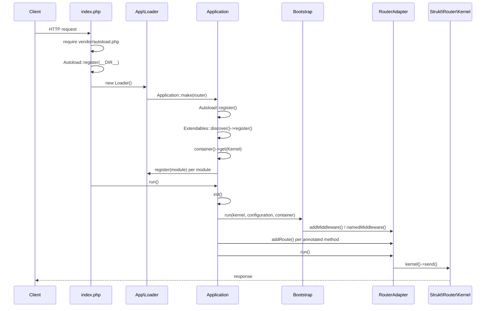

# Architecture

This document describes how `strukt/framework` is put together: the layers, the
responsibilities of each component, the collaborators they depend on, and the
lifecycle of a request.

The framework is a thin orchestration layer over a set of focused `strukt4`
packages. It does not implement routing, caching, validation, or HTTP itself;
it discovers application configuration and threads it into those packages.

## Design goals

1. **Annotation driven.** Routers, forms, middleware, providers, and validators
   describe themselves in docblocks. The application reads those annotations and
   translates them into the configuration the underlying packages expect.
2. **Ports and adapters.** The application depends on the `Kernel` port rather
   than `Strukt\Router\Router`, so the transport can be swapped without touching
   the rest of the framework.
3. **Constructor injection.** Collaborators are resolved from a PSR-11 container
   with autowiring, and every binding falls back to a global accessor so an
   application works even without a container.
4. **Single responsibility.** Each class owns one job (`Application` sequences,
   `Registrar` indexes, `Bootstrap` wires, `Shell` dispatches, `Documenter`
   renders, and so on).
5. **Zero-configuration extensions.** Anything under `lib/App` that implements a
   known extension interface is discovered automatically.

## Dependency layers

```
              +--------------------------------------------------+
   console    |  bin/strukt -> Shell -> CommandRepository         |
              |                 -> CommandFactory -> Command       |
              +--------------------------------------------------+
                                      |
              +--------------------------------------------------+
   kernel     |  Application                                       |
              |    |-- Registrar  (module -> facet index)          |
              |    |-- Configuration (package settings, cached)   |
              |    |-- Bootstrap  (providers + middleware)         |
              |    |-- Kernel port -> RouterAdapter -> Router      |
              +--------------------------------------------------+
                                      |
              +--------------------------------------------------+
   runtime    |  Autoload (PSR-4 for App\ and app/src/*)          |
              |  Extendables (validators, middleware, providers)  |
              |  Container (PSR-11)                               |
              |  Configuration / Environment / Reloader           |
              +--------------------------------------------------+
                                      |
              +--------------------------------------------------+
   packages   |  strukt/router cache form rules event fs          |
              |  generator console base commons contract          |
              +--------------------------------------------------+
```

## Components

### Application kernel

[`Strukt\Framework\Application`](../src/Strukt/Framework/Application.php) is the
orchestrator. It owns no logic of its own; it sequences three collaborators:

| Collaborator | Responsibility |
| --- | --- |
| [`Registrar`](../src/Strukt/Framework/Module/Registrar.php) | Indexes registered modules and their facets. |
| [`Bootstrap`](../src/Strukt/Framework/Bootstrap.php) | Applies providers and middleware to the kernel. |
| `Kernel` (wrapped by [`RouterAdapter`](../src/Strukt/Framework/Router/RouterAdapter.php)) | Receives routes and dispatches requests. |

Composition happens in `Application::make()`: it registers the autoloader,
discovers application extendables, resolves the kernel and configuration from the
shared container, and resolves the registrar.

```php
$app = Application::make();      // build
$app->register(new AuthModule()); // index facets
$app->run();                      // init + dispatch
```

`register()` is idempotent by module namespace; `init()` is separate so a caller
can inspect routes before dispatch; `handle()` initialises and returns a response
instead of sending it.

### Module system

A [module](../src/Strukt/Framework/Contract/Module.php) is a namespace that
groups application facets. The base class reflects the concrete module to expose
its directory and namespace, and a protected `$alias` names it.

The [`Registrar`](../src/Strukt/Framework/Module/Registrar.php) walks a module's
directory and indexes each facet file into a [`ModuleStore`](../src/Strukt/Framework/Contract/ModuleStore.php)
under `nr.<alias>.<facet>.<name>`, plus a `nr.routes.<alias>` list of routers.
The facet folders are configured in `cfg/module.ini` (`ctr`, `rtr`, `frm`,
`tes`). Two stores ship:

- [`RegistryStore`](../src/Strukt/Framework/Module/Storage/RegistryStore.php) —
  writes through the shared `reg()` registry (the default).
- [`MemoryStore`](../src/Strukt/Framework/Module/Storage/MemoryStore.php) —
  in-memory, for tests and isolated runtimes.

### Configuration and packages

[`Configuration`](../src/Strukt/Framework/Configuration.php) assembles the
providers, middleware, and commands contributed by every *published* package for
the active application type (`App:Idx` or `App:Cli`). The result is cached per
type so discovery runs once.

Package discovery goes through the [`BundlesRepositoryInterface`](../src/Strukt/Framework/Contract/BundlesRepositoryInterface.php)
port ([`BundlesRepository`](../src/Strukt/Framework/Bundle/BundlesRepository.php) is
the default, backed by [`Strukt\Bundle\Bundles`](../src/Strukt/Bundle/Bundles.php)).
See [bundles.md](bundles.md) for details.

### Routing

The [`Kernel`](../src/Strukt/Framework/Contract/Kernel.php) port is the only HTTP
surface the framework knows: `addRoute()`, `addMiddleware()`,
`namedMiddleware()`, `run()`, and `handle()`.
[`RouterAdapter`](../src/Strukt/Framework/Router/RouterAdapter.php) implements it
over `Strukt\Router\Router`, translating the flattened route configuration into
router calls. Route annotations are read by
[`Injectable\Router`](../src/Strukt/Framework/Injectable/Router.php). See
[routing.md](routing.md).

### Dependency injection

[`Container`](../src/Strukt/Framework/Container/Container.php) is a small PSR-11
container with constructor autowiring. The framework registers its own
collaborators on the shared instance exposed by the `container()` helper. See
[dependency-injection.md](dependency-injection.md).

### Extensions

[`Extendables`](../src/Strukt/Framework/Extendables.php) performs a single
discovery pass over `lib/App` and classifies each class by the interface it
implements (validator, middleware, provider). Validators are registered on the
shared rule registry; middleware and providers are merged into the bootstrap.
See [extensions.md](extensions.md).

### Console

[`Shell`](../src/Strukt/Framework/Shell.php) dispatches commands. It delegates
discovery and parsing to [`CommandRepository`](../src/Strukt/Framework/Console/CommandRepository.php),
instantiation to a [`CommandFactory`](../src/Strukt/Framework/Console/CommandFactory.php)
(the default is container-backed), and documentation rendering to
[`Documenter`](../src/Strukt/Framework/Console/Documenter.php). See
[console.md](console.md).

### Runtime scaffolding

| Class | Responsibility |
| --- | --- |
| [`Autoload`](../src/Strukt/Framework/Autoload.php) | Registers a PSR-4 loader for `App\` and each `app/src/*` directory. |
| [`Environment`](../src/Strukt/Framework/Environment.php) | Writes the default `.env` when one is missing. |
| [`Reloader`](../src/Strukt/Framework/Reloader.php) | Renders `lib/App/Loader.php` from the module tree and scaffolds the front controller. |

## Request lifecycle

There are two entry points: the front controller (`index.php`, for HTTP) and the
console binary (`bin/strukt`). Both converge on the same boot sequence.



Step by step:

1. **Autoload.** `Autoload::register()` maps `App\` onto `rel_app_lib`
   (`lib/App`) and each first-level directory under `rel_appsrc` (`app/src`) onto
   its own prefix. No `composer dump-autoload` is required.
2. **Compose.** `Application::make()` builds the container, resolves the kernel
   (or wraps a supplied router), resolves `Configuration` when the application
   declares an `App\Injectable` class, and resolves the `Registrar`.
3. **Discover extendables.** `Extendables::discover()` scans `lib/App` and
   registers validators on the shared rule registry.
4. **Register modules.** Each `register(new SomeModule())` indexes the module's
   facets into the module store.
5. **Initialise.** `init()` publishes `nr.modules`, runs `Bootstrap`, then walks
   every router facet and registers its annotated methods as routes with the
   kernel.
6. **Bootstrap.** Providers are built (through the container when available),
   `register()`ed, and `boot()`ed. Middleware is queued on the kernel pipeline and
   aliased by its `@Name`.
7. **Dispatch.** `run()` sends the response; `handle($request)` returns it. The
   router kernel invokes the route action, resolving parameters (matched route
   params, request/response/session/auth by interface, validated forms, named
   bindings), and maps errors to responses.

## Registry keys

The shared `reg()` registry is the discovery backbone:

| Key | Contents |
| --- | --- |
| `nr.modules` | Module namespaces keyed by alias. |
| `nr.<alias>.<facet>.<name>` | A facet class (for example `nr.au.ctr.User`). |
| `nr.routes.<alias>` | Router classes for a module alias. |
| `router` | The shared router instance (`Strukt\Router\Router`). |

`core('au.ctr.User')` resolves a facet through the `provider.core` event; the
`Facet` provider registered by the core package owns that resolution.

## Error handling

- `Shell::run()` catches `Throwable`, writes `Error: <message>` to STDERR, and
  returns exit code `1`.
- The router kernel maps `ValidationException` to `422` with a JSON body,
  `MethodNotAllowedException` to `405`, and other known exceptions to their code
  (falling back to `500`).
- `raise()` (base helper) throws and is used for configuration and filesystem
  errors.

## Relationship to `strukt1/strukt-framework`

This package is a modern, full port of `strukt1/strukt-framework` onto the
`strukt4` packages (PHP 8.2, typed properties, enums-free, PSR-11/PSR-4). The
public behavior — annotations, module aliases, the `core()` resolver, the
console commands — is preserved; the internals are decomposed into the focused
collaborators described above.
